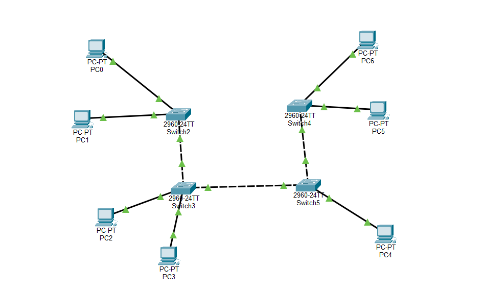
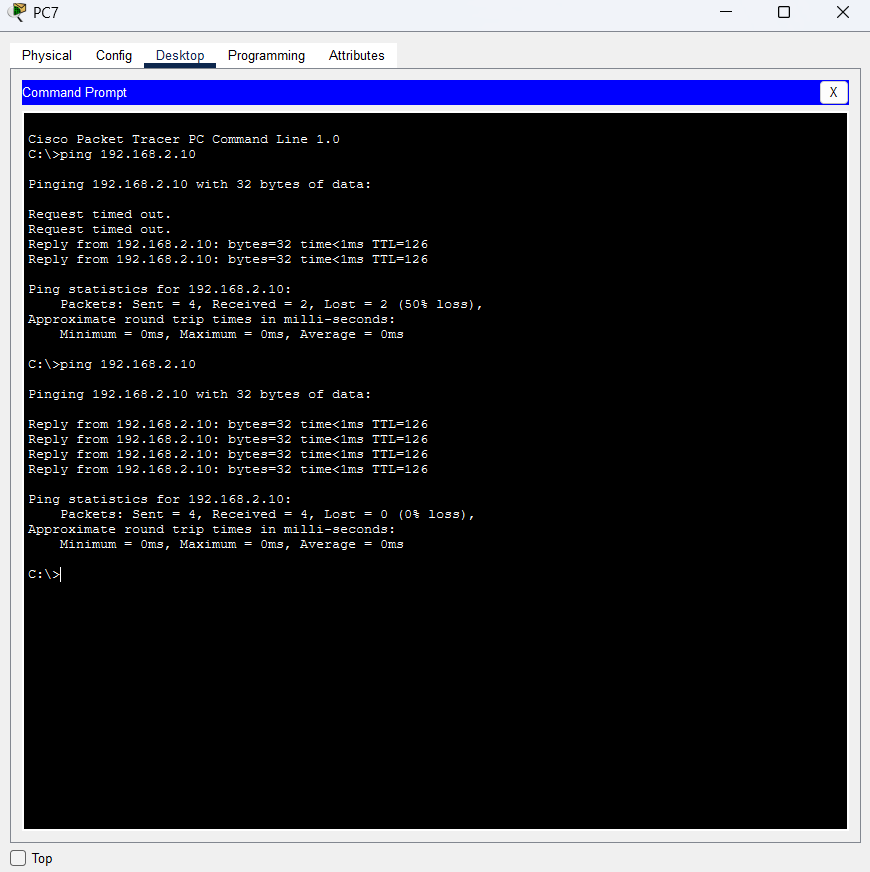
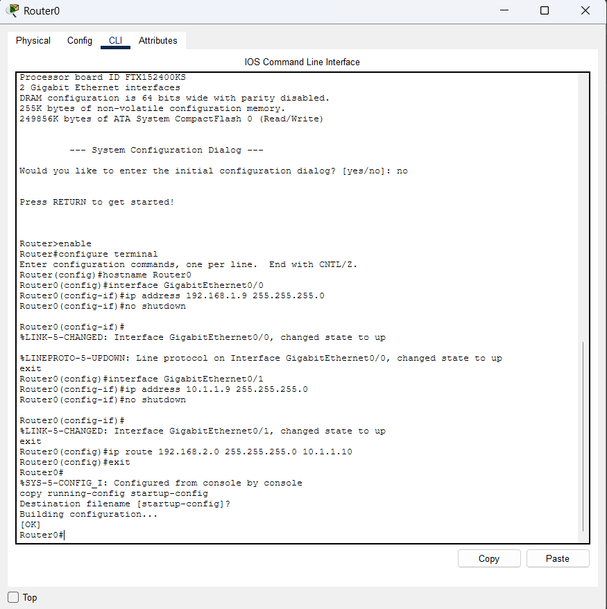
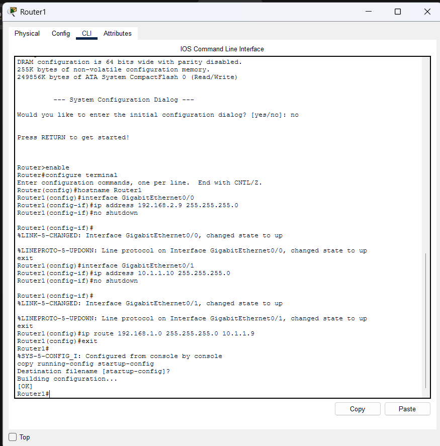
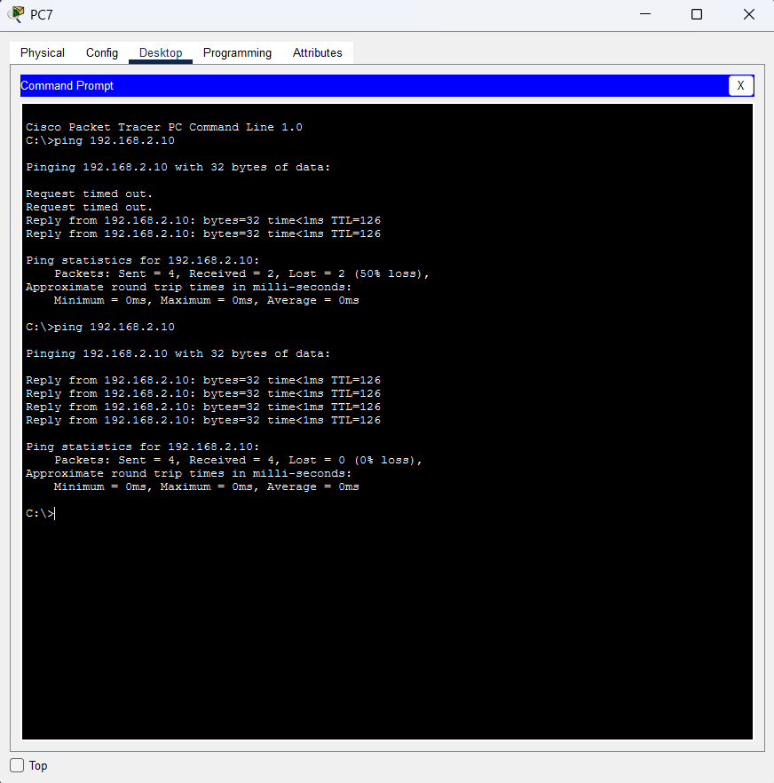

Министерство образования Республики Беларусь

Учреждение образования

“Брестский Государственный технический университет”

Кафедра ИИТ

       

Лабораторная работа №4

По дисциплине “Аппаратное и Программное обеспечение сетей”

Тема: “изучение пакета CISCO PACKETTRACER. начальная конфигурация маршрутизатора CISCO”

Вариант: 9

     

Выполнил:

Студент 3 курса

Группы ИИ-27

Соловчук И.Г.

Проверила:

Кулик А.Д.

     

Брест 2026

# Цель
Изучить интерфейс эмулятора Cisco Packet Tracer, научиться добавлять и соединять сетевые устройства, настраивать IP-адресацию на ПК, проверять связность командой ping, а также изучить начальную конфигурацию маршрутизатора Cisco и принципы работы таблицы маршрутизации.

# Ход работы

## Практическая часть 1

В рабочей области Packet Tracer были добавлены два коммутатора Switch-PT (Switch0, Switch1) и четыре персональных компьютера (PC0–PC3). Устройства соединены кабелями типа Copper Straight-Through / Copper Cross-Over согласно схеме.

|Устройство|IP-адрес|Маска подсети|
|----------|--------|-------------|
|PC0|192.168.1.2|255.255.255.0|
|PC1|192.168.1.3|255.255.255.0|
|PC2|192.168.1.4|255.255.255.0|
|PC3|192.168.1.5|255.255.255.0|

Настройка выполнялась через вкладку Desktop → IP Configuration

Сохранение произведено здесь

Вывод команды ipconfig с одного ПК:

С компьютера PC3 была выполнена проверка связи с PC0 командой ping 192.168.1.2

## Работа с CLI коммутатора

Был открыт интерфейс командной строки коммутатора через вкладку CLI. Проверен список доступных команд с помощью ?.

## Задание для самостоятельной работы

Топология по рисунку 1.7 (Вариант 9).

Мой вариант 9, поэтому таблица адресов выглядит так:

|Устройство|IP-адрес|Маска подсети|
|----------|--------|-------------|
|PC0|9.1.1.1|255.255.255.0|
|PC1|9.1.1.2|255.255.255.0|
|PC2|9.1.1.3|255.255.255.0|
|PC3|9.1.1.4|255.255.255.0|
|PC4|9.1.1.5|255.255.255.0|
|PC5|9.1.1.6|255.255.255.0|
|PC6|9.1.1.7|255.255.255.0|

Настройка IP-адресов на ПК:

Проверка работоспособности сети с использованием ping:

## Часть 2. Начальная конфигурация маршрутизатора Cisco

Была собрана топология с двумя маршрутизаторами (Router0 и Router1), двумя коммутаторами и двумя ПК (PC7, PC8) для демонстрации маршрутизации.

Настройка маршрутизатора Router0 через интерфейс командной строки (CLI):

Настройка маршрутизатора Router1 через интерфейс командной строки (CLI):

Проверка связи между PC7 и PC8 (разные подсети) с помощью команды ping:

# Вывод

В ходе лабораторной работы были изучены основные возможности эмулятора Cisco Packet Tracer и получены практические навыки построения и настройки локальной сети. Была выполнена настройка IP-адресации для 9-го варианта, проверена связность с помощью утилиты ping. Во второй части работы были изучены принципы начальной конфигурации маршрутизаторов Cisco, настроены интерфейсы, включены порты командой `no shutdown`, прописаны статические маршруты и проверена маршрутизация между различными подсетями.